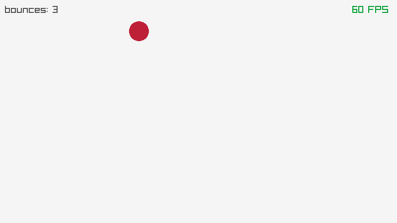

# Raylib

[raylib](https://www.raylib.com/) for [Zevic](https://github.com/zevic-lang/zevic): a window, 2D drawing, keyboard and mouse. The public API uses only Zevic types; a small C layer (`native/zv_raylib.c`) takes plain numbers, so no struct is ever passed by value to C.

This first version covers the basics. Textures, sound, fonts and 3D are not wrapped yet.

## Install

Needs raylib 5 and its development files. Ubuntu has no package for it, so build it (this is what CI does; macOS can also use `brew install raylib`):

```
git clone --depth 1 --branch 5.5 https://github.com/raysan5/raylib.git
cmake -S raylib -B raylib/build -DCMAKE_BUILD_TYPE=Release -DBUILD_SHARED_LIBS=ON -DBUILD_EXAMPLES=OFF -DCMAKE_INSTALL_PREFIX="$HOME/raylib" -DCMAKE_INSTALL_NAME_DIR="$HOME/raylib/lib"
cmake --build raylib/build -j 4 && cmake --install raylib/build
```

On Linux the build needs `cmake`, `libgl1-mesa-dev`, `libx11-dev`, `libxrandr-dev`, `libxi-dev`, `libxcursor-dev`, `libxinerama-dev` and `libxkbcommon-dev`.

Then add the package to your project:

```
zevpm get zevic-lang/raylib@v0.5.0
```

or in `zevic.toml`:

```
[deps]
Raylib = { git = "https://github.com/zevic-lang/raylib", tag = "v0.5.0" }
```

If raylib is not in a standard place (`/usr/local` for example), tell clang where it is before you build and run:

```
export C_INCLUDE_PATH="$HOME/raylib/include" LIBRARY_PATH="$HOME/raylib/lib" LD_LIBRARY_PATH="$HOME/raylib/lib"
```

(`zevic.toml` can only name the library with `[native] libs`; it has no keys for folders.)

## Use

```
module Main

import Raylib

fn Main() {
    Raylib.InitWindow(800, 450, "hello")
    defer Raylib.CloseWindow()
    Raylib.SetTargetFps(60)

    while (!Raylib.WindowShouldClose()) {
        Raylib.BeginDrawing()
        Raylib.ClearBackground(Raylib.RayWhite())
        Raylib.DrawText("Hello from Zevic", 190, 200, 20, Raylib.Gray())
        Raylib.EndDrawing()
    }
}
```

A bigger one is in `examples/bounce`: `cd examples/bounce && zevpm run`.



## API

| | |
| --- | --- |
| `InitWindow(w, h, title)` `CloseWindow()` `WindowShouldClose()` `SetTargetFps(n)` `ScreenWidth()` `ScreenHeight()` | the window |
| `FrameTime()` `Time()` `Fps()` | timing |
| `BeginDrawing()` `EndDrawing()` `ClearBackground(c)` | one frame |
| `DrawText` `MeasureText` `DrawRect` `DrawRectLines` `DrawCircle` `DrawLine` `DrawFps` | drawing |
| `IsKeyDown(k)` `IsKeyPressed(k)` `IsKeyReleased(k)` `KeySpace` `KeyEscape` `KeyEnter` `KeyUp` `KeyDown` `KeyLeft` `KeyRight` `KeyA` `KeyD` `KeyS` `KeyW` | keyboard |
| `MouseX()` `MouseY()` `IsMouseDown(b)` `IsMousePressed(b)` `MouseLeft` `MouseRight` `MouseMiddle` | mouse |
| `Color.New(r, g, b, a)` `c.WithAlpha(a)` and the palette as functions (`Red()`, `Blue()`, `RayWhite()`, ...) | colors |

The palette is made of functions (`Raylib.Red()`), not constants: the compiler reads the value of a constant in the caller's module, where `Color` is not in scope.

Call everything from the main thread, and only between `InitWindow` and `CloseWindow`.

## Test

```
zevpm test
```

The tests need no window. Opening one needs a display, so CI checks the drawing by running `examples/bounce` for a few seconds under a virtual display (Xvfb with Mesa's software renderer) and looking at a screenshot of it (the picture above is one). It runs on Linux; macOS builds and tests only.

## Releases

A push to `main` that passes the tests in CI is released by the workflow when `version` in `zevic.toml` has no tag yet: it creates the tag `vX.Y.Z` and a GitHub release whose notes are the `## X.Y.Z` section of `CHANGELOG.md`. To release, raise `version`, add that section, and push to `main`.

## License

Apache-2.0
